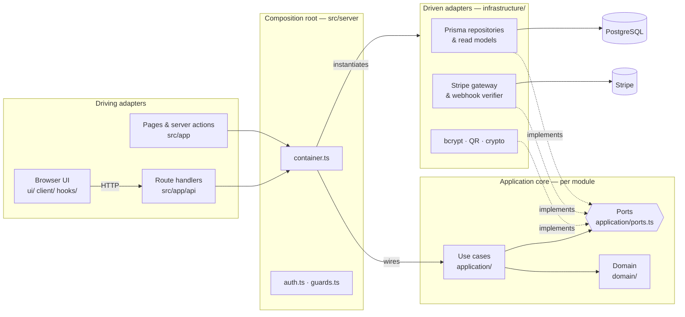

# Meridian — Architecture

Meridian is a **hexagonal (ports and adapters) modular monolith**: one Next.js app, split into feature modules, each built around a pure core.

- **Domain**: business rules as plain TypeScript. No framework, no I/O.
- **Application**: use cases. Each one is a class with an `execute` method. It depends only on the domain and on **ports**: interfaces it declares for what it needs (a repository, a payment gateway, a clock).
- **Infrastructure**: **adapters** that implement those ports with Prisma, Stripe, bcrypt, QR codes, and Node crypto.
- **Composition root** (`src/server/`): the one place that chooses which adapter fills which port.
- **Driving adapters**: Next.js pages, route handlers, and server actions in `src/app`, plus browser UI in each module's `ui/`, `client/`, and `hooks/`. They call use cases; they never contain business rules.

`tests/architecture.test.ts` enforces every rule below, so `npm test` fails when a change crosses a boundary.

## 1) The shape



Dependencies point **inward**. The domain knows nothing, use cases know the domain and their ports, and adapters know the ports they implement. Only the composition root knows everything.

## 2) Folder structure

```text
src/
├─ app/                               Driving adapters: pages, route handlers, server actions
│  ├─ api/…/route.ts                  parse → authorize → container().<module>.<useCase>.execute() → respond
│  └─ admin/shows/actions.ts          "Create show" server action (FormData → CreateShow)
├─ middleware.ts                      Auth.js gate for /admin and /bookings
│
├─ server/                            Composition root
│  ├─ container.ts                    builds adapters, injects them into use cases (lazy singleton)
│  ├─ auth.ts                         Auth.js wiring; identity is wired here to keep the Edge bundle small
│  └─ guards.ts                       requireUser · requireAdmin · getApiSession
│
├─ modules/
│  ├─ seating/                        Seat inventory and holds
│  │  ├─ domain/                      hold-policy.ts (selection, expiry, claimability) · errors.ts · types.ts
│  │  ├─ application/                 ports.ts (SeatHoldRepository, ShowInventoryReader, HoldTokenGenerator)
│  │  │                               use-cases.ts (HoldSeats, ReleaseHold, GetShowInventory, GetActiveHold)
│  │  ├─ infrastructure/              prisma-seat-hold.repository.ts (row locks) · prisma-show-inventory.reader.ts
│  │  │                               crypto-hold-token.generator.ts
│  │  ├─ client/ · ui/                fetch wrappers · SeatMap, SeatButton, SeatLegend
│  │  └─ schemas.ts                   Zod request contracts
│  ├─ booking/                        From hold to paid tickets
│  │  ├─ domain/                      booking.ts (totals, expiry, confirmability) · ticket.ts (QR payload)
│  │  │                               payment-event.ts · errors.ts
│  │  ├─ application/                 ports.ts (BookingRepository, BookingUnitOfWork, PaymentGateway, …)
│  │  │                               start-checkout.ts · confirm-paid-booking.ts · handle-payment-event.ts
│  │  │                               read-models.ts · checkout-failure.ts
│  │  ├─ infrastructure/              prisma-booking.repository.ts (+ unit of work) · prisma-booking.queries.ts
│  │  │                               stripe/ (gateway, webhook verifier) · qrcode-ticket-renderer.ts
│  │  └─ client/ · ui/ · schemas.ts
│  ├─ catalog/                        domain/ (show formats, ShowSummary) · application/read-models.ts · infrastructure/
│  ├─ admin/                          domain/scheduling.ts · application/ (CreateShow, AdminQueries) · infrastructure/
│  ├─ identity/                       domain/roles.ts · application/authenticate-user.ts · infrastructure/ (Prisma, bcrypt)
│  ├─ seat-preview/                   domain/ (metrics, Aperture, camera math) · ui/ (Three.js hall, canvas)
│  └─ show-experience/                The show page: ShowExperience + hooks/ + ui/ (browser only)
│
└─ shared/
   ├─ kernel/ports.ts                 Clock, IdGenerator: ports any module may use
   ├─ lib/                            cn, formatMoney/seatLabel, clamp
   ├─ server/                         db.ts (Prisma client) · env.ts · http.ts · rate-limit.ts · system.ts (clock, ids)
   ├─ design/                         show-visuals.ts (palette, chrome layout) · use-show-chrome.ts
   └─ ui/                             button, Sheet
```

## 3) Dependency rules

| From \ may import | domain | application | infrastructure | browser (ui/client/hooks) | shared/server | src/server |
| --- | :-: | :-: | :-: | :-: | :-: | :-: |
| **domain** | ✓ | ✗ | ✗ | ✗ | ✗ | ✗ |
| **application** | ✓ | ✓ | ✗ | ✗ | ✗ | ✗ |
| **infrastructure** | ✓ | ✓ (ports) | ✓ | ✗ | ✓ | ✗ |
| **browser** | ✓ | ✗ | ✗ | ✓ | ✗ | ✗ |
| **src/app** | ✓ | ✓ (types, pure helpers) | ✗ | ✓ | http, rate-limit | ✓ |

The architecture test also checks that:

- **Domain** imports no frameworks, no Node I/O, and no Zod.
- **Application** imports no frameworks (React, Next, Prisma, Stripe, bcrypt, QR) and no Node I/O.
- **Only adapters and the composition root** import the Prisma client.
- **Only routes and middleware** import the composition root. Modules never do.
- **Shared** code imports no module, route, or wiring code.
- **Cross-module imports** follow the graph below, and only reach another module's `domain/` or browser code, never its use cases or adapters.

```text
show-experience ──► seating, seat-preview, booking, catalog   (browser composition)
booking ──► seating, seat-preview                              (UI types only)
admin ──► catalog                                              (ShowFormat)
identity · catalog · seating · seat-preview ──► shared only
```

**Booking does not import seating.** `StartCheckout` declares an `ActiveHoldReader` port, and the container fills it with seating's `GetActiveHold` use case. **Payments is not a module.** Stripe is a booking adapter (`booking/infrastructure/stripe/`) behind the `PaymentGateway` and `PaymentWebhookVerifier` ports, so replacing Stripe touches one folder.

There are no barrel `index.ts` files. Importing specific files keeps server-only code out of client bundles.

## 4) Request flows

### Hold — `POST /api/shows/:showId/hold`
Route: `getApiSession` (401) → rate limit (429) → `holdSeatsSchema` (400) → `container().seating.holdSeats.execute()`.

`HoldSeats` de-duplicates the selection (`normalizeSeatSelection`, empty → `SeatHoldError NOT_FOUND`), computes the expiry from the clock and `SEAT_HOLD_MINUTES`, takes a token from `HoldTokenGenerator`, and calls `SeatHoldRepository.claim`. The Prisma adapter's `claim` runs one transaction:

1. `SELECT … FOR UPDATE` on the requested rows and the user's other holds, in seat-id order.
2. Expire stale holds on those seats.
3. Reject seats the user cannot claim (domain `unclaimableSeats` → `SeatHoldError UNAVAILABLE` → 409).
4. Release the user's other holds on the show.
5. Mark the seats `HELD` with the token and expiry, and increment `version`.

### Inventory — `GET /api/shows/:showId/seats` and `/shows/[showId]`
`GetShowInventory` expires stale holds, then asks the `ShowInventoryReader` for the show and its seats projected for the viewer (`SeatViewModel`). The browser polls the endpoint every 4 s.

### Checkout — `POST /api/checkout`
`StartCheckout`:

1. Reads the active hold through `ActiveHoldReader`. Empty → `NoActiveHoldError`, which maps to 409 "Your seat hold expired…".
2. Loads the show (`ShowLookup`), totals the price, and takes the earliest hold expiry (domain).
3. Creates a `PENDING_PAYMENT` booking (`BookingRepository`).
4. If `PaymentGateway.isConfigured()` is false, confirms locally (demo mode). Otherwise it opens a payment session with one line item per seat and `bookingId/showId/userId/holdToken` metadata, then attaches the session id. Outside production, a gateway failure falls back to demo mode.

### Payment confirmation — `POST /api/webhooks/stripe`
`PaymentWebhookVerifier` (Stripe adapter) checks the signature and normalises the event into a domain `PaymentEvent`. `HandlePaymentEvent` confirms paid, completed checkouts through `ConfirmPaidBooking`, which runs inside `BookingUnitOfWork.run` (one DB transaction):

- Already `CONFIRMED`: return without writing (idempotent, so Stripe retries are safe).
- Any seat no longer `HELD`/`BOOKED`: throw `SeatsNoLongerHeldError`.
- Otherwise: seats become `BOOKED`, the booking becomes `CONFIRMED`, the payment is upserted, and one QR ticket is issued per seat (unless tickets already exist).

### Sign-in
Auth.js credentials provider → `AuthenticateUser` (Zod-validated input, `UserRepository`, `PasswordHasher`). Any failure returns `null`.

### Show page (browser)
`ShowExperience` only composes. State lives in hooks: `useSeatInventory` and `useSeatPolling` (inventory and the 4 s poll), `useSeatBooking` (select → hold with 409 retry → checkout, release, expiry), `useSpatialPreview` (VR toggle), and `useToast`.

## 5) Testing strategy

| Layer | How it is tested |
| --- | --- |
| Domain | Plain unit tests: `seat-pov`, `metrics`, `aperture`, `show-visuals`, hold and booking rules |
| Application | Use cases with in-memory fakes for every port (`tests/application/`): holds, checkout (Stripe, demo, fallback, errors), idempotent confirmation, payment events, sign-in, show scheduling |
| Boundaries | `tests/architecture.test.ts` |
| Adapters | Need PostgreSQL and Stripe test keys. Run `node scripts/verify-e2e.mjs` against a seeded dev server. `tests/seat-lock.test.ts` documents the concurrency check |

## 6) Configuration

`shared/server/env.ts` is the only reader of app settings: `SEAT_HOLD_MINUTES`, `NEXT_PUBLIC_APP_URL`, `STRIPE_SECRET_KEY`, `STRIPE_WEBHOOK_SECRET`, and `NODE_ENV`. The container passes them into use cases and adapters as functions, so tests set them directly. Auth.js reads `AUTH_SECRET`/`AUTH_URL`, and Prisma reads `DATABASE_URL`.

## 7) Adding a feature

1. **Domain:** write the rule as a pure function or type in the owning module's `domain/`, and unit test it.
2. **Port:** in `application/`, declare an interface for anything the use case needs from outside (storage, a provider, time).
3. **Use case:** write a class with `execute`, injected with ports. Test it with fakes.
4. **Adapter:** implement the port in `infrastructure/`.
5. **Wire:** construct it in `src/server/container.ts`.
6. **Expose:** call `container().<module>.<useCase>.execute()` from a route, page, or server action.
7. **New module:** add `src/modules/<name>/` and register it in `ALLOWED_MODULE_DEPS`.

## 8) Data model

- `ShowSeat` is the inventory row for `(showId, seatId)`: `status = AVAILABLE | HELD | BOOKED | BLOCKED`, `holdExpiresAt`, `heldByUserId`, `holdToken`, and `version`. Row locks on it prevent double booking.
- `Seat` stores hall-local coordinates. The 3D view and the metrics share one frame: screen at z = 0, seats at z > 0 facing −z.
- `Booking` → `Ticket` (QR payload) and `Payment` (Stripe ids and the raw event).

## 9) Trade-offs

- **Read models skip the domain.** Listing and admin pages go through query ports (`CatalogQueries`, `AdminQueries`, `BookingQueries`) that return page-shaped DTOs straight from Prisma. Commands get the full domain → use case → port treatment; queries stay thin. This is CQRS-lite.
- **The hold transaction lives in the adapter.** Row locking is a database capability, so `claim` owns the transaction, but the claimability rule it applies comes from the domain.
- **Realtime:** 4 s polling. A push transport would replace `useSeatPolling` only.
- **Rate limiting:** in-memory and per process. Swap `shared/server/rate-limit.ts` for Redis before scaling out.
- **Hold expiry:** lazy, on reads and holds. A scheduled job calling `SeatHoldRepository.expireStaleHolds()` would release seats sooner.
